# Notchi

**The notch, with personality.** A free, open-source, fully animated macOS desktop suite. The notch, wallpaper, dock, icons, sidebar, menu bar, sounds and cursor all follow one theme.

> Free forever. No paywalls, no subscriptions, no ads, no tracking.

> Not affiliated with the other open-source project named "notchi" (the Claude Code notch mascot). Notchi here is the whole-desktop theming suite.

## The notch island (v0.1)

| Music | Terminal | Progress |
|---|---|---|
| 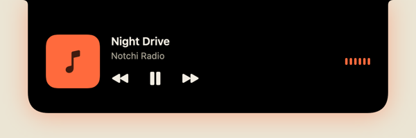 | 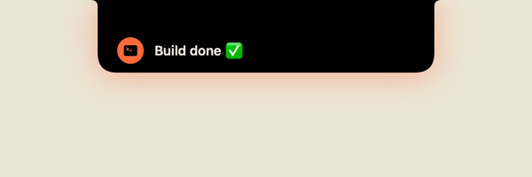 | 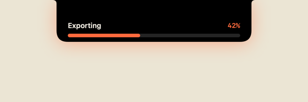 |
| 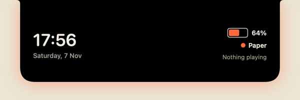 | 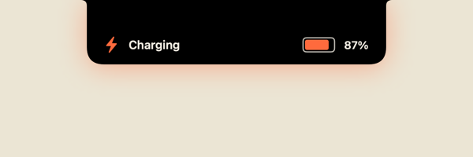 | 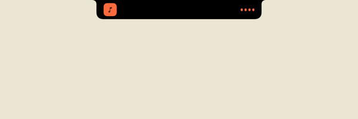 |
| 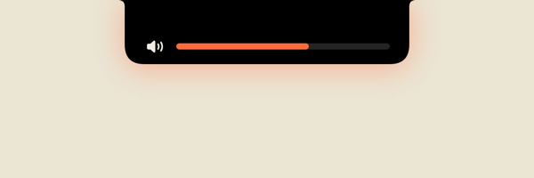 | 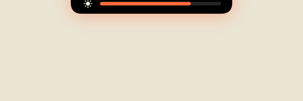 | 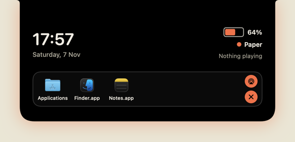 |
| 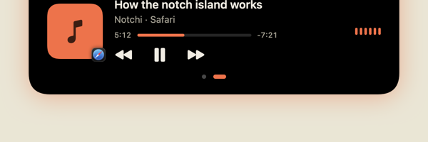 | 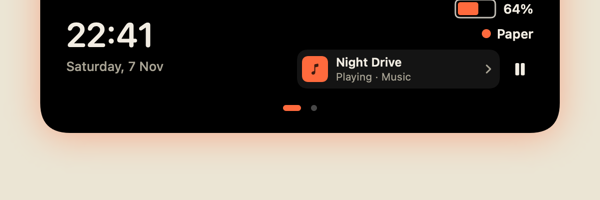 | |

The open notch has pages: **Home** (time, battery and what's playing), **Now Playing** and
the **File shelf**. Tap the dots or swipe with two fingers to switch; tap the now-playing pill
on Home to open the player. It slides back to Home after 10 seconds or when the notch closes.

### Now playing from any app

The notch shows whatever macOS shows in Control Center: a YouTube tab in Safari or Chrome,
Music, Spotify, Podcasts, VLC, IINA and so on, with artwork (or the app's icon), a live
progress bar and play/pause/skip. Since macOS 15.4 only Apple-signed processes can read
this, so Notchi loads a tiny helper ([Helpers/MediaRemoteBridge](Helpers/MediaRemoteBridge))
into `/usr/bin/perl`, the same approach other open-source notch apps use. Nothing leaves
your Mac. If a future macOS blocks it, Notchi falls back to Music and Spotify only.

### Volume and brightness in the notch

macOS has no setting to hide its own volume and brightness indicator, so Notchi catches
those keys first, changes the level itself and shows it in the notch. The macOS
indicator never appears. This needs **Accessibility** access, which Notchi asks for only
when you turn it on (menu bar → *Volume & Brightness in the Notch*, or Settings).
Shift+Option+key gives fine steps, and Option+key still opens System Settings like before.
Brightness uses DisplayServices, the private framework MonitorControl also uses, because
macOS has no public brightness API. If it's ever missing, the keys go back to macOS.
`notchi doctor` tells you whether it's on.

> **Building it yourself?** Ad hoc builds get a new code signature on every rebuild, and
> macOS silently stops applying the Accessibility grant (the switch still looks on), so the
> macOS indicator comes back. Run `./scripts/dev-signing.sh` once: it makes a local signing
> identity in its own keychain file and `bundle.sh` uses it from then on. Then allow Notchi
> once more. `notchi doctor` tells you if this is the problem.

Regenerate with `dist/Notchi.app/Contents/MacOS/Notchi --snapshot docs/snapshots`.

## Repo layout

| Folder | What it is |
|---|---|
| `web/` | The website (Next.js, deployed on Vercel) |
| `App/` | The menu-bar app (`Notchi.app`) |
| `Packages/NotchiCore` | Theme engine, event bus, energy governor, notch detection, Now Playing, battery |
| `Packages/NotchiNotch` | The notch island and its live activities |
| `CLI/notchi` | The `notchi` command-line tool |
| `Themes/` | Built-in themes |
| `PROJECT_BLUEPRINT.md` | The full product plan |

## Build and run the app

macOS 14+ and Swift 6 (Xcode or just the Command Line Tools).

```bash
./scripts/bundle.sh        # builds dist/Notchi.app and dist/notchi
open dist/Notchi.app       # hover the notch to open it
./scripts/test.sh          # run the tests
```

## The `notchi` command

```bash
notchi notify "Build done ✅"          # show a message in the notch
notchi progress 42 "Exporting"         # show progress (100 hides it)
notchi apply midnight                  # apply a theme
notchi theme list                      # list themes
notchi status                          # what the notch is showing
notchi doctor                          # check setup and conflicts
```

Use it in scripts: `npm run build && notchi notify "Build done ✅" || notchi notify "Build failed ❌"`

## Run the website

```bash
cd web
npm install
npm run dev
```

## Licence

App: GPL-3.0. Plugin SDK: MIT. Built-in themes and assets: CC BY 4.0.
